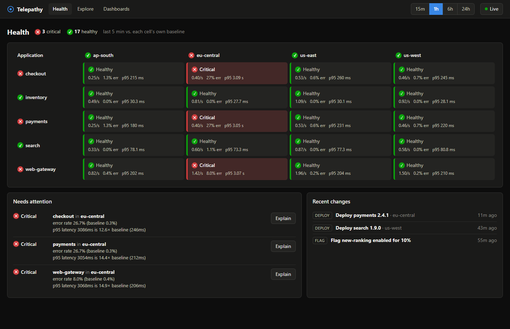
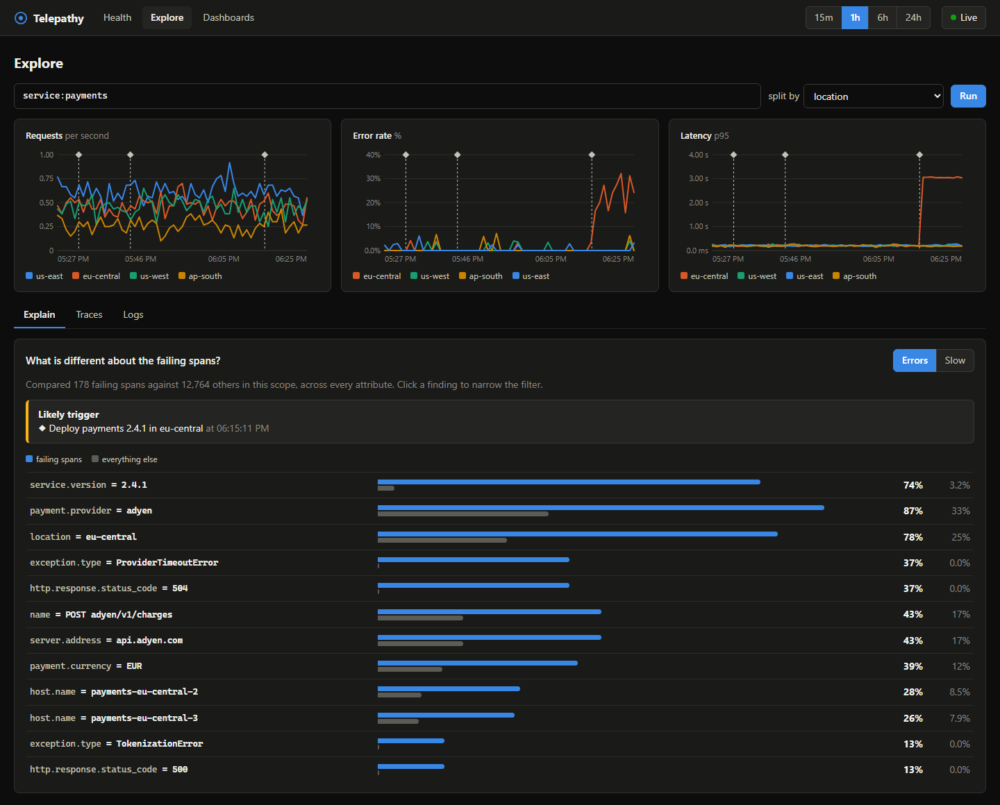
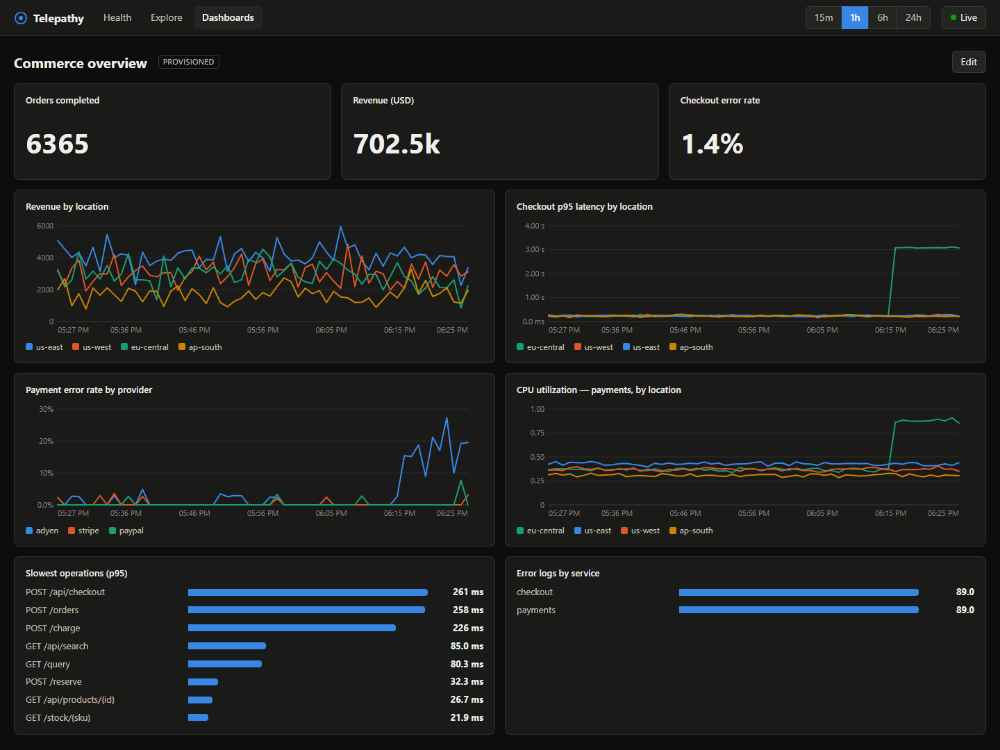

# Telepathy

**Know what your systems are experiencing without interrogating them.**

Telepathy is an OpenTelemetry-native observability platform in a single binary:
it ingests traces, logs and metrics from production, shows the health of every
application at every location, explains *why* something broke, and lets you
build custom dashboards.



> **Status: early (M0).** A working vertical slice — real OTLP ingest, real
> queries, real UI — not yet production-hardened. See the
> [product spec](docs/PRODUCT_SPEC.md) for where this is going and
> [architecture](docs/ARCHITECTURE.md) for how it works and its current limits.

## What is different

- **Health without configuration.** Every application × location cell is judged
  against its own recent baseline. No monitors to author, no thresholds to guess.
  Cells that go quiet are flagged as *silent* rather than disappearing.
- **Location is a first-class dimension** — a region, a store, a clinic, an edge
  site — not a tag you have to remember to group by.
- **Explain, one click away.** Telepathy compares failing (or slow) requests
  against healthy ones across *every* attribute and tells you what is
  over-represented.
- **Changes are telemetry.** Deploys and flag flips are recorded with one `curl`,
  drawn on every chart, and offered as the likely trigger.
- **One query for everything.** The same filter language and query object power
  exploration, dashboards and (next) alerts — across traces, logs and metrics.
- **No proprietary agent.** OTLP in. Point any OTel SDK or Collector at it.



## Quick start

Requires Go 1.26+ and Node 24+.

```sh
git clone https://github.com/gthimmes/telepathy && cd telepathy
cd web && npm ci && npm run build && cd ..     # build the UI (embedded into the binary)
go run ./cmd/telepathy serve --demo            # serve + simulated telemetry
```

Open <http://localhost:4318>. `--demo` simulates a five-service commerce system
in four locations, including an incident: a bad `payments` deploy in
`eu-central` that only breaks one payment provider. Find it on the Health page,
click **Explain**, and open a failing trace.

Or with Docker:

```sh
docker build -t telepathy . && docker run -p 4318:4318 telepathy serve --demo
```

## Send your own telemetry

Telepathy listens for OTLP/HTTP (protobuf or JSON) on the standard port, so the
standard OpenTelemetry environment variables are all you need:

```sh
OTEL_EXPORTER_OTLP_ENDPOINT=http://localhost:4318
OTEL_EXPORTER_OTLP_PROTOCOL=http/protobuf
OTEL_SERVICE_NAME=checkout
OTEL_RESOURCE_ATTRIBUTES=telepathy.location=store-042,deployment.environment.name=production
```

A location is resolved from the first of `telepathy.location`, `location`,
`site.id`, `cloud.region`, `cloud.availability_zone`, `k8s.cluster.name`
(change with `--location-keys`).

Record a deploy from CI so it shows up on charts and in Explain:

```sh
curl -X POST http://localhost:4318/api/v1/events \
  -d '{"kind":"deploy","service":"checkout","location":"store-042","title":"checkout 3.8.0"}'
```

## Using it

| Page | What it answers |
|---|---|
| **Health** | Is everything OK, everywhere? What needs attention and why? What changed recently? |
| **Explore** | Rate, errors and latency for any filter, split by any attribute — then **Explain**, matching **Traces**, and **Logs** |
| **Trace** | The waterfall of one request across services, with its errors and logs |
| **Dashboards** | Build your own from time series, single numbers and top lists over any signal |

Filter language (same everywhere):

```
service:checkout location:eu-* status:error duration>500ms -http.route:/healthz "card declined"
```

**Dashboards as code.** Any `*.json` in [`dashboards/`](dashboards/) is
provisioned at startup; the dashboard editor exports the same format.



## Configuration

`telepathy serve` flags (and environment variables):

| Flag | Env | Default | |
|---|---|---|---|
| `--addr` | `TELEPATHY_ADDR` | `:4318` | Listen address for UI, API and OTLP |
| `--db` | `TELEPATHY_DB` | `telepathy.db` | Database file |
| `--retention` | | `168h` | How long to keep telemetry |
| `--dashboards` | `TELEPATHY_DASHBOARDS` | `dashboards` | Dashboards-as-code directory |
| `--location-keys` | `TELEPATHY_LOCATION_KEYS` | see above | Resource attributes that define a location |
| `--ingest-key` | `TELEPATHY_INGEST_KEY` | none | Require `Authorization: Bearer <key>` on OTLP ingest |
| `--demo` | | off | Generate simulated telemetry |

`telepathy demo --endpoint http://host:4318` sends the simulated system to a
running server (or to any OTLP/HTTP endpoint).

> The API and UI have no authentication yet — run it on a trusted network.

## Development

```sh
go test ./...                       # backend tests
go run ./cmd/telepathy serve --demo # backend on :4318
cd web && npm run dev               # UI with hot reload, proxied to :4318
```

The API is documented in [docs/ARCHITECTURE.md](docs/ARCHITECTURE.md#http-api).

## Roadmap

Next up (M1): alerting on health transitions, authentication, OTLP/gRPC, a
service map, and a ClickHouse storage backend. After that: SLOs, location
hierarchy, an MCP server for AI agents, and the predictive pillar (forecasting,
anomaly detection, deploy risk scoring). Details in the
[product spec](docs/PRODUCT_SPEC.md#8-roadmap).
