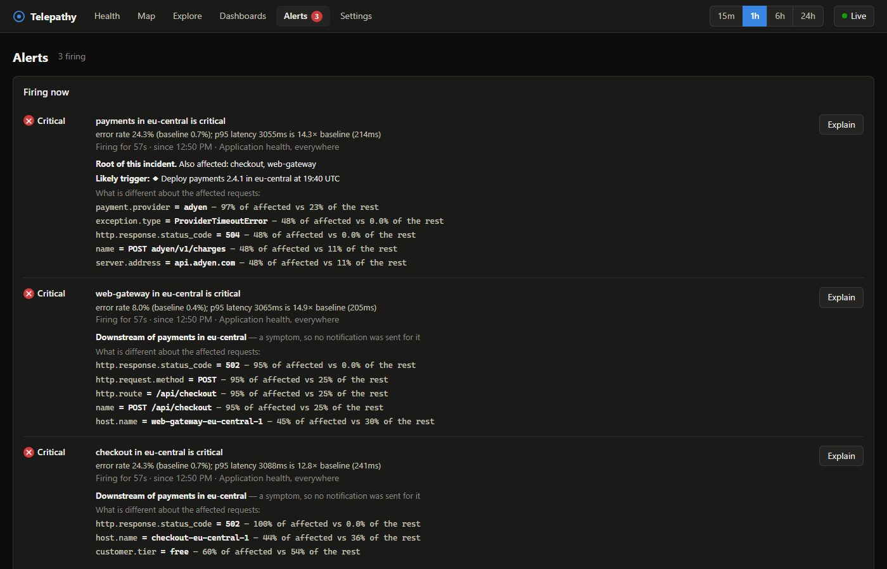
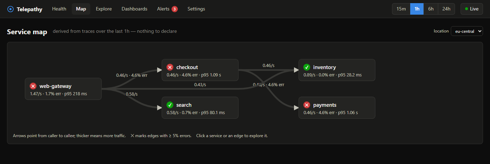

# Telepathy

**Know what your systems are experiencing without interrogating them.**

Telepathy is an OpenTelemetry-native observability platform in a single binary:
it ingests traces, logs and metrics from production, shows the health of every
application at every location, alerts you with the probable cause attached,
explains *why* something broke, and lets you build custom dashboards.


> **Status: early (M1).** Real OTLP ingest, queries, alerting, authentication
> and UI, on an embedded store sized for a team rather than a fleet. See the
> [product spec](docs/PRODUCT_SPEC.md) for where this is going and
> [architecture](docs/ARCHITECTURE.md) for how it works and its current limits.

## What is different

- **Health without configuration.** Every application × location cell is judged
  against its own recent baseline. No monitors to author, no thresholds to guess.
  Cells that go quiet are flagged as *silent* rather than disappearing.
- **Location is a first-class dimension** — a region, a store, a clinic, an edge
  site — not a tag you have to remember to group by.
- **Explain, one click away.** Telepathy compares failing (or slow) requests
  against healthy ones across *every* attribute and tells you what is
  over-represented.
- **Alerts that arrive with a hypothesis.** Alerting works out of the box from
  the health matrix. Each notification carries the Explain result and the
  deploy that probably caused it — and when a failure cascades through several
  services, only the root one pages you.
- **Changes are telemetry.** Deploys and flag flips are recorded with one `curl`,
  drawn on every chart, and offered as the likely trigger.
- **One query for everything.** The same filter language and query object power
  exploration, dashboards and monitors — across traces, logs and metrics.
- **No proprietary agent.** OTLP in (HTTP and gRPC). Point any OTel SDK or
  Collector at it.



## Quick start

Requires Go 1.26+ and Node 24+.

```sh
git clone https://github.com/gthimmes/telepathy && cd telepathy
cd web && npm ci && npm run build && cd ..     # build the UI (embedded into the binary)
go run ./cmd/telepathy serve --demo            # serve + simulated telemetry
```

Open <http://localhost:4318>. `--demo` simulates a five-service commerce system
in four locations, including an incident: a bad `payments` deploy in
`eu-central` that only breaks one payment provider. Within a minute the Alerts
page shows it, names the deploy, and marks `checkout` and `web-gateway` as
downstream symptoms.

Or with Docker:

```sh
docker build -t telepathy . && docker run -p 4318:4318 -p 4317:4317 telepathy serve --demo
```

## Send your own telemetry

Telepathy listens for OTLP/HTTP (protobuf or JSON) on 4318 and OTLP/gRPC on
4317 — the standard ports — so the standard OpenTelemetry environment variables
are all you need:

```sh
OTEL_EXPORTER_OTLP_ENDPOINT=http://localhost:4318
OTEL_EXPORTER_OTLP_PROTOCOL=http/protobuf        # or grpc, with port 4317
OTEL_SERVICE_NAME=checkout
OTEL_RESOURCE_ATTRIBUTES=telepathy.location=store-042,deployment.environment.name=production
```

A location is resolved from the first of `telepathy.location`, `location`,
`site.id`, `cloud.region`, `cloud.availability_zone`, `k8s.cluster.name`
(change with `--location-keys`).

Record a deploy from CI so it shows up on charts, in Explain and in alerts:

```sh
curl -X POST http://localhost:4318/api/v1/events \
  -d '{"kind":"deploy","service":"checkout","location":"store-042","title":"checkout 3.8.0"}'
```

## Using it

| Page | What it answers |
|---|---|
| **Health** | Is everything OK, everywhere? What needs attention and why? What changed recently? |
| **Map** | Who calls whom, derived from traces, with health and traffic on every node and edge |
| **Explore** | Rate, errors and latency for any filter, split by any attribute — then **Explain**, matching **Traces**, and **Logs** |
| **Trace** | The waterfall of one request across services, with its errors and logs |
| **Dashboards** | Build your own from time series, single numbers and top lists; narrow any dashboard by service or location |
| **Alerts** | What is firing, why, and what probably caused it; monitors and notification channels |
| **Settings** | API tokens and how to connect |



Filter language (same everywhere):

```
service:checkout location:eu-* status:error duration>500ms -http.route:/healthz "card declined"
```

**Dashboards as code.** Any `*.json` in [`dashboards/`](dashboards/) is
provisioned at startup; the dashboard editor exports the same format.


## Alerting

A health monitor exists from the first start: it alerts when any
application × location cell becomes critical, degraded or silent, with no
thresholds to set. Add **query monitors** on the Alerts page for anything else
(“p95 of checkout > 800 ms over 5 m, per location”) — they use the same query
as the explorer and dashboards.

Add a **Slack**, **PagerDuty** or generic **webhook** channel on the same page.
A condition must hold for two consecutive evaluations (30 s apart) before it
fires or resolves. Set `--public-url` so links in notifications point at your
server.

## Authentication

Authentication is off by default so the quick start needs no setup. Turn it on
with an admin password:

```sh
TELEPATHY_ADMIN_PASSWORD='…' telepathy serve
```

People then sign in with that password. Programs use **API tokens**, created
under Settings, sent as `Authorization: Bearer tp_…` over HTTP or gRPC:

| Role | Can |
|---|---|
| `ingest` | Send telemetry (OTLP) and change events. For services, collectors and CI. |
| `read` | Query everything, change nothing. For scripts, reports and AI agents. |
| `admin` | Everything, including dashboards, monitors, channels and tokens. |

```sh
OTEL_EXPORTER_OTLP_HEADERS=Authorization=Bearer%20tp_…
```

Telepathy serves plain HTTP; put it behind a TLS-terminating proxy for anything
beyond a trusted network.

## Configuration

`telepathy serve` flags (and environment variables):

| Flag | Env | Default | |
|---|---|---|---|
| `--addr` | `TELEPATHY_ADDR` | `:4318` | Listen address for UI, API and OTLP/HTTP |
| `--grpc-addr` | `TELEPATHY_GRPC_ADDR` | `:4317` | OTLP/gRPC listen address (`off` to disable) |
| `--db` | `TELEPATHY_DB` | `telepathy.db` | Database file |
| `--retention` | | `168h` | How long to keep telemetry |
| `--dashboards` | `TELEPATHY_DASHBOARDS` | `dashboards` | Dashboards-as-code directory |
| `--location-keys` | `TELEPATHY_LOCATION_KEYS` | see above | Resource attributes that define a location |
| `--admin-password` | `TELEPATHY_ADMIN_PASSWORD` | none | Turn on authentication (prefer the env var) |
| `--ingest-key` | `TELEPATHY_INGEST_KEY` | none | A static key accepted on OTLP ingest, as an alternative to tokens |
| `--public-url` | `TELEPATHY_PUBLIC_URL` | `http://localhost:4318` | Base URL for links in notifications |
| `--no-alerts` | | off | Do not evaluate monitors or notify |
| `--demo` | | off | Generate simulated telemetry |

`telepathy demo --endpoint http://host:4318` sends the simulated system to a
running server (or to any OTLP/HTTP endpoint).

`telepathy bench` is the load test: it pushes simulated telemetry through the
real ingest path into a fresh database and times the queries the UI depends on.
Results from one run are in [docs/ARCHITECTURE.md](docs/ARCHITECTURE.md#measured-performance).

## Development

```sh
go test ./...                       # backend tests
go run ./cmd/telepathy serve --demo # backend on :4318
cd web && npm run dev               # UI with hot reload, proxied to :4318
```

The API is documented in [docs/ARCHITECTURE.md](docs/ARCHITECTURE.md#http-api).

## Roadmap

Done: M0 (foundation) and M1 (alerting, authentication, OTLP/gRPC, service map,
dashboard variables, load test). Next (M2): a columnar storage backend for
scale, SLOs, location hierarchy, RBAC, an MCP server for AI agents. After that,
the predictive pillar: forecasting, anomaly detection and deploy risk scoring.
Details in the [product spec](docs/PRODUCT_SPEC.md#8-roadmap).

## License

[Apache License 2.0](LICENSE).
